### ▍SYSTEM.TELEMETRY

### ▍ACTIVITY.LOG

### ▍CONTRIB.MATRIX

### ▍STACK.SCAN

### ▍RECENT.DEPLOYMENTS

<!-- PROFILE:START -->
| Repository | Description | Lang | Stars | Last push |
|:--|:--|:--:|:--:|:--:|
| [**TrackRadar**](https://github.com/YueyuHoshizora/TrackRadar) | YouTube 資料抓取系統 | `TypeScript` | ★ 1 | 2026-10-14 |
| [**AMusic**](https://github.com/YueyuHoshizora/AMusic) | 聽見音樂 AMusic | `HTML` | ★ 0 | 2026-10-14 |
| [**YuStellar-Site**](https://github.com/YueyuHoshizora/YuStellar-Site) | — | `JavaScript` | ★ 0 | 2026-10-13 |
| [**YuMeewADE**](https://github.com/YueyuHoshizora/YuMeewADE) | — | `TypeScript` | ★ 0 | 2026-10-13 |
| [**YuMeewMusic**](https://github.com/YueyuHoshizora/YuMeewMusic) | YuMeew。音樂視覺工作室 | `JavaScript` | ★ 3 | 2026-10-01 |
| [**suno-lyrics-bridge**](https://github.com/YueyuHoshizora/suno-lyrics-bridge) | Chrome extension: fetch Suno aligned lyrics timing, export SRT/LRC, import into YuMeew subtitle editor. | `JavaScript` | ★ 0 | 2026-09-23 |
<!-- PROFILE:END -->

---

  
    <code>// public data only · auto-refreshed every 5 minutes by <a href="./.github/workflows/profile.yml">GitHub Actions</a> · rendered by <a href="./scripts/generate.mjs">generate.mjs</a></code>
  

