### ▍SYSTEM.TELEMETRY

### ▍ACTIVITY.LOG

### ▍CONTRIB.MATRIX

### ▍STACK.SCAN

### ▍NETWORK.NODES

---

  
    <code>// public data only · auto-refreshed every 5 minutes by <a href="./.github/workflows/profile.yml">GitHub Actions</a> · rendered by <a href="./scripts/generate.mjs">generate.mjs</a></code>
  

